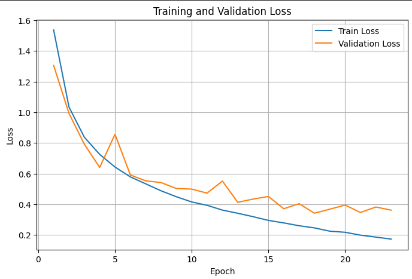
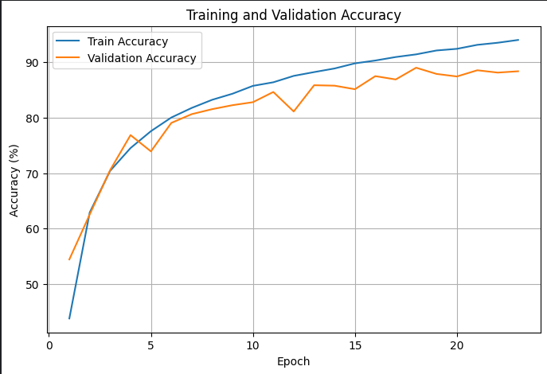
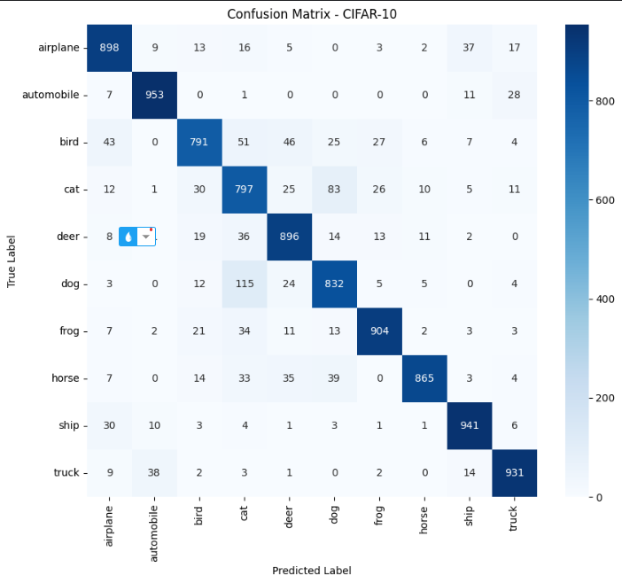
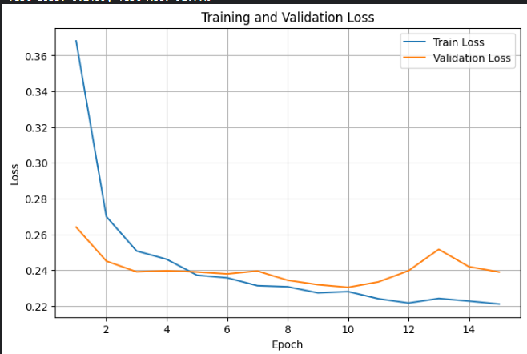
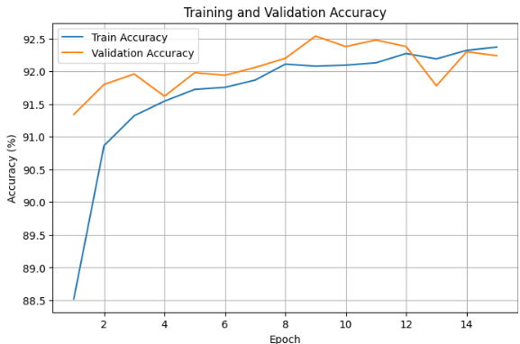
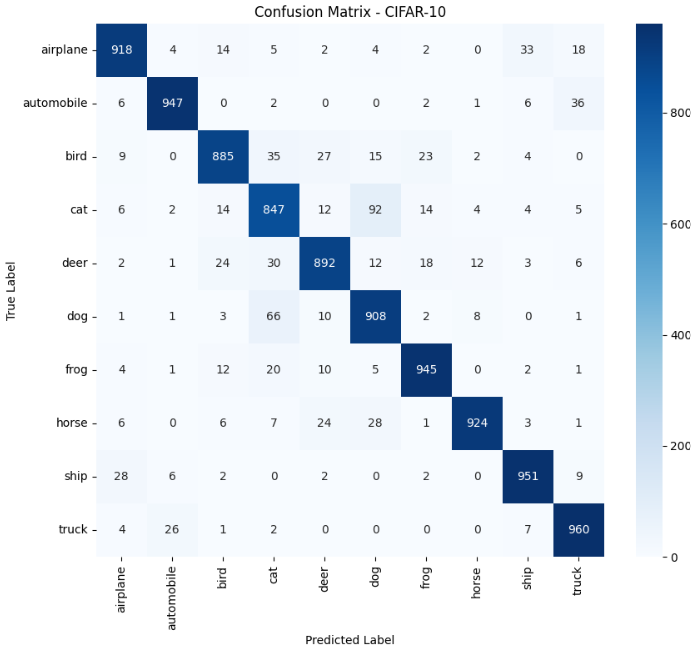

# Phân loại ảnh CIFAR-10 với PyTorch

Báo cáo thực nghiệm hai mô hình: **CNN tự xây dựng, huấn luyện từ đầu** và **EfficientNet-B0 pretrained, đóng băng backbone và huấn luyện lớp phân loại cuối**. Kết quả được tổng hợp từ log chạy trên Kaggle và các biểu đồ.

**Trạng thái:** đã có kết quả CNN và EfficientNet-B0. SmallViT có trong mã nguồn nhưng đang chạy; chưa đưa vào bảng so sánh kết quả.

## 1. Mục tiêu và dữ liệu

Mục tiêu là xây dựng quy trình phân loại ảnh gồm chuẩn bị dữ liệu, huấn luyện, chọn checkpoint theo validation loss và đánh giá bằng accuracy, precision, recall, F1-score cùng confusion matrix.

[CIFAR-10](https://www.cs.toronto.edu/~kriz/cifar.html) gồm 60.000 ảnh màu RGB kích thước 32 × 32, thuộc 10 lớp. Bộ dữ liệu gốc có 50.000 ảnh train và 10.000 ảnh test; mỗi lớp có đúng 1.000 ảnh trong tập test [1].

| Tập dữ liệu trong thí nghiệm | Số ảnh | Vai trò |
|---|---:|---|
| Train | 45.000 | Cập nhật trọng số |
| Validation | 5.000 | Chọn checkpoint và early stopping |
| Test | 10.000 | Đánh giá checkpoint được chọn |

Các lớp theo thứ tự nhãn 0–9: `airplane`, `automobile`, `bird`, `cat`, `deer`, `dog`, `frog`, `horse`, `ship`, `truck`.

Hàm tạo DataLoader dùng `random_split` một lần với generator seed 42 để lấy chỉ số train/validation. Sau đó dùng các chỉ số này trên hai bản dataset có transform khác nhau, giúp train có augmentation còn validation không có augmentation. Hai mô hình dùng cùng cách chia tập; đây là chia ngẫu nhiên, không phải chia phân tầng theo lớp.

### Tiền xử lý

| Thiết lập | CNN | EfficientNet-B0 |
|---|---|---|
| Augmentation train | RandomCrop(32, padding=4), RandomHorizontalFlip | RandomCrop(32, padding=4), RandomHorizontalFlip trước khi resize |
| Kích thước đầu vào | 32 × 32 | Resize trực tiếp thành 224 × 224 |
| Nội suy khi resize | Không áp dụng | Theo `weights.transforms().interpolation`, antialias=True |
| Chuyển dữ liệu | ToTensor | ToTensor |
| Mean | (0.4914, 0.4822, 0.4465) | (0.485, 0.456, 0.406) |
| Std | (0.2470, 0.2435, 0.2616) | (0.229, 0.224, 0.225) |

Validation và test chỉ dùng tiền xử lý xác định, không dùng crop/lật ngẫu nhiên. Với EfficientNet, code lấy mean, std và nội suy từ bộ weights pretrained [2]; pipeline thực tế **resize trực tiếp về 224 × 224**, không gọi toàn bộ pipeline mặc định resize 256 rồi center crop 224.

## 2. Mô hình

### 2.1. CNN tự xây dựng

Mỗi lớp convolution dùng kernel 3 × 3, padding 1, theo sau bởi BatchNorm và ReLU. Sau mỗi cặp convolution có MaxPool2d(2, 2).

| Thành phần | Các phép biến đổi | Đầu ra mỗi ảnh (C × H × W) |
|---|---|---|
| Input | Ảnh RGB | 3 × 32 × 32 |
| Block 1 | Conv 3→32, Conv 32→64, MaxPool | 64 × 16 × 16 |
| Block 2 | Conv 64→128, Conv 128→128, MaxPool | 128 × 8 × 8 |
| Block 3 | Conv 128→256, Conv 256→256, MaxPool | 256 × 4 × 4 |
| Classifier | Flatten → Linear(4096,512) → ReLU → Dropout(0.1) → Linear(512,10) | 10 logits |

CNN không dùng trọng số pretrained. Đầu ra là logits đưa trực tiếp vào `CrossEntropyLoss`, không thêm softmax trong `forward`.

### 2.2. EfficientNet-B0

Mô hình dùng `torchvision.models.efficientnet_b0` với `EfficientNet_B0_Weights.DEFAULT`, tương ứng weights ImageNet-1K V1 [2]. Cách sử dụng trong thí nghiệm:

- Đóng băng toàn bộ `model.features` bằng `requires_grad_(False)`.
- Giữ lớp Dropout có sẵn; thay lớp Linear cuối bằng Linear có 10 đầu ra.
- Khi gọi `train()`, các block features đang đóng băng được đặt về `eval()`.
- Optimizer chỉ nhận các tham số có `requires_grad=True`.

Đây là **feature extraction với backbone pretrained cố định**. Class có hàm `unfreeze_last_blocks`, nhưng phần chạy được cung cấp không gọi hàm này; kết quả hiện tại chưa bao gồm fine-tuning backbone.

## 3. Thiết lập huấn luyện và đánh giá

| Tham số | CNN | EfficientNet-B0 |
|---|---|---|
| Batch size (train/valid/test) | 128 | 32 |
| Epoch tối đa | 50 | 50 |
| Optimizer | AdamW | Adam |
| Learning rate ban đầu | 0.001 | 0.001 |
| Loss | CrossEntropyLoss | CrossEntropyLoss |
| Scheduler | CosineAnnealingLR(T_max=50) | CosineAnnealingLR(T_max=50) |
| Early stopping | patience=5, theo validation loss | patience=5, theo validation loss |
| Checkpoint | `best_cnn_model.pth` | `best_ef_model.pth` |

Code đặt seed toàn cục 42 ở đầu notebook; generator chia dữ liệu cũng có seed 42. Các tham số optimizer khác giữ mặc định của thư viện. Riêng `weight_decay` không được truyền tường minh: mặc định AdamW là 0.01 [3], Adam là 0; không coi đây là hai cấu hình optimizer giống nhau.

Checkpoint được lưu khi **validation loss giảm**, không chọn theo validation accuracy. Sau khi kết thúc huấn luyện, `train_model` nạp lại checkpoint này trước khi chạy test. Scheduler được cập nhật sau mỗi epoch nếu vòng lặp chưa dừng sớm. Loss được báo cáo đúng theo code: lấy trung bình loss của các mini-batch; accuracy tính trên toàn bộ số ảnh.

Precision, recall và F1-score được tính theo từng lớp. Macro average là trung bình không trọng số qua 10 lớp; các giá trị này nằm trong khoảng 0–1, còn accuracy được trình bày theo phần trăm. Với tập test cân bằng 1.000 ảnh/lớp, macro recall bằng accuracy khi biểu diễn ở thang 0–1.

## 4. Kết quả tổng hợp

| Chỉ số | CNN | EfficientNet-B0 |
|---|---:|---:|
| Số epoch thực chạy | 23 | 15 |
| Epoch của checkpoint được chọn | 18 | 10 |
| Validation loss nhỏ nhất | 0.3416 | 0.2305 |
| Validation accuracy tại checkpoint (%) | 89.02 | 92.38 |
| Validation accuracy cao nhất trong log (%) | 89.02 (epoch 18) | 92.54 (epoch 9) |
| Test loss | 0.3749 | Chưa được cung cấp |
| **Test accuracy (%)** | **88.08** | **91.77*** |
| Macro precision | 0.8829 | 0.9185 |
| Macro recall | 0.8808 | 0.9177 |
| **Macro F1-score** | **0.8812** | **0.9179** |

\* **Nguồn của 91.77%:** log EfficientNet được gửi chưa có dòng test loss/accuracy. Confusion matrix có tổng đường chéo `918+947+885+847+892+908+945+924+951+960 = 9177`, trên 10.000 ảnh test, nên accuracy là `9177/10000 × 100 = 91.77%`. Giá trị này cũng khớp macro recall 0.9177. Không suy ra được test loss từ confusion matrix hay các metric này.

Trong lần chạy được báo cáo, EfficientNet-B0 cao hơn CNN **3.69 điểm phần trăm** test accuracy và **0.0367** macro F1. Đây là so sánh hai cấu hình thực nghiệm cụ thể; chưa phải phép thử chỉ thay đổi kiến trúc vì pretrained, độ phân giải, batch size và optimizer đều khác nhau.

### 4.1. CNN







Train loss giảm từ 1.5368 xuống 0.1726 và train accuracy tăng từ 43.76% lên 94.03%. Validation loss tốt nhất là 0.3416 ở epoch 18. Từ epoch 19 đến 23, validation loss không thấp hơn mốc này nên early stopping được kích hoạt sau 5 epoch liên tiếp không cải thiện.

Ở epoch cuối, train accuracy là 94.03% trong khi validation accuracy là 88.38%, chênh 5.65 điểm phần trăm. Train tiếp tục cải thiện nhưng validation loss không vượt mốc epoch 18, cho thấy dấu hiệu overfitting ở giai đoạn cuối. Test được thực hiện với checkpoint epoch 18, **không phải** trọng số epoch 23.

Lớp `automobile` có F1 cao nhất (0.9464), còn `cat` thấp nhất (0.7627). Hai chiều nhầm lẫn `cat → dog` và `dog → cat` lần lượt là 83 và 115 ảnh.

### 4.2. EfficientNet-B0







Ngay epoch đầu, mô hình đạt train accuracy 88.52% và validation accuracy 91.34%. Kết quả ban đầu cao phù hợp với việc sử dụng backbone pretrained; thí nghiệm hiện tại chưa tách riêng tác động của pretrained khỏi các khác biệt cấu hình khác.

Validation loss thấp nhất là 0.2305 ở epoch 10. Epoch 9 có validation accuracy cao hơn (92.54%), nhưng checkpoint vẫn là epoch 10 (92.38%) vì tiêu chí lựa chọn là loss. Năm epoch 11–15 không cải thiện validation loss nên mô hình dừng ở epoch 15.

Lớp `automobile` có F1 cao nhất (0.9527); `cat` vẫn thấp nhất (0.8411). `cat → dog` có 92 ảnh và `dog → cat` có 66 ảnh. Tổng hai chiều giảm từ 198 xuống 158 ảnh so với CNN, nhưng riêng chiều `cat → dog` vẫn tăng từ 83 lên 92 ảnh.

### 4.3. Precision, recall và F1 theo lớp

| Lớp | CNN P | CNN R | CNN F1 | EfficientNet P | EfficientNet R | EfficientNet F1 |
|---|---:|---:|---:|---:|---:|---:|
| airplane | 0.8770 | 0.8980 | 0.8874 | 0.9329 | 0.9180 | 0.9254 |
| automobile | 0.9398 | 0.9530 | 0.9464 | 0.9585 | 0.9470 | 0.9527 |
| bird | 0.8740 | 0.7910 | 0.8304 | 0.9209 | 0.8850 | 0.9026 |
| cat | 0.7312 | 0.7970 | 0.7627 | 0.8353 | 0.8470 | 0.8411 |
| deer | 0.8582 | 0.8960 | 0.8767 | 0.9111 | 0.8920 | 0.9015 |
| dog | 0.8246 | 0.8320 | 0.8283 | 0.8534 | 0.9080 | 0.8798 |
| frog | 0.9215 | 0.9040 | 0.9127 | 0.9366 | 0.9450 | 0.9408 |
| horse | 0.9590 | 0.8650 | 0.9096 | 0.9716 | 0.9240 | 0.9472 |
| ship | 0.9198 | 0.9410 | 0.9303 | 0.9388 | 0.9510 | 0.9449 |
| truck | 0.9236 | 0.9310 | 0.9273 | 0.9257 | 0.9600 | 0.9426 |
| **Macro Avg** | **0.8829** | **0.8808** | **0.8812** | **0.9185** | **0.9177** | **0.9179** |

F1-score của EfficientNet cao hơn CNN ở cả 10 lớp trong lần chạy này. Mức tăng lớn nhất thuộc về `cat` (+0.0784), tiếp theo là `bird` (+0.0722). Tuy vậy, recall không tăng ở mọi lớp: `automobile` giảm từ 0.9530 xuống 0.9470, và `deer` giảm từ 0.8960 xuống 0.8920.

## 5. Nhận xét và giới hạn

CNN tự xây dựng đạt 88.08% test accuracy khi học từ đầu. EfficientNet-B0 dùng backbone pretrained cố định đạt 91.77% theo confusion matrix và macro F1 0.9179, cho kết quả tổng thể tốt hơn trong hai lần chạy được cung cấp. Nhóm lớp động vật, đặc biệt `cat` và `dog`, vẫn xuất hiện nhầm lẫn đáng chú ý.

Các giới hạn khi diễn giải kết quả:

- Mỗi mô hình hiện có một lần chạy được cung cấp; chưa có trung bình và độ lệch chuẩn qua nhiều seed.
- Hai cấu hình khác nhau về pretrained, độ phân giải, batch size và optimizer; chưa thể quy toàn bộ chênh lệch cho riêng kiến trúc.
- Chưa có thời gian huấn luyện, thời gian suy luận, GPU cụ thể và phiên bản thư viện của lần chạy; số epoch ít hơn không đủ để kết luận chạy nhanh hơn theo thời gian thực.
- Chưa có test loss của EfficientNet. Không thay bằng validation loss hoặc một giá trị ước lượng.
- Chạy riêng từng mô hình trong `main.py` có thể tiêu thụ trạng thái RNG khác với chạy các cell nối tiếp trong notebook. Seed 42 không bảo đảm tái tạo chính xác từng chữ số trên môi trường khác.
- ViT đang chạy và chưa có kết quả để so sánh.

Bước tiếp theo là bổ sung kết quả ViT, dòng đánh giá test đầy đủ của EfficientNet và thông tin môi trường thực tế. Nếu cần kết luận ổn định hơn, có thể thực hiện thêm các lần chạy độc lập theo nhiều seed; đây là hướng bổ sung, chưa phải kết quả đã làm.

## 6. Cấu trúc và cách chạy

| Đường dẫn | Nội dung |
|---|---|
| `main.py` | Chọn mô hình, train, test và hiển thị biểu đồ |
| `models/cnn.py` | CNN tự xây dựng |
| `models/efficientnet.py` | EfficientNet-B0 pretrained |
| `models/vit.py` | SmallViT và các thành phần attention |
| `utils/data.py` | Transform, chia dữ liệu và DataLoader |
| `utils/train.py` | Seed, train, evaluate |
| `utils/plot.py` | Vẽ biểu đồ và tính metrics |
| `results/figures/` | Sáu hình gốc được đổi tên theo mô hình |
| `results/*_history.csv` | Log theo epoch được chép từ kết quả Kaggle |
| `results/*_metrics.csv` | Precision, recall và F1 đã cung cấp |
| `results/summary.json` | Tóm tắt kết quả, ghi rõ số liệu được suy ra |
| `report/main.tex` | Bản báo cáo LaTeX dùng trên Overleaf |
| `report/figures/` | Bản sao ảnh để upload riêng thư mục report |
| `report/Bao_cao_CIFAR10.pdf` | Bản PDF đã biên dịch |

Trong Terminal ở thư mục project trên Windows:

```powershell
py -m venv .venv
.\.venv\Scripts\python.exe -m pip install -r requirements.txt
```

Chọn `MODEL_NAME = "cnn"` hoặc `MODEL_NAME = "efficientnet"` trong `main.py`, sau đó chạy:

```powershell
.\.venv\Scripts\python.exe main.py
```

Dataset được lưu trong `data/`; EfficientNet tải weights pretrained khi khởi tạo nếu chưa có cache. Code train, kiến trúc và tham số của project được giữ nguyên trong lần bổ sung báo cáo này. Code hiện hiển thị biểu đồ bằng `plt.show()`; các hình trong báo cáo là hình của lần chạy Kaggle đã cung cấp, không phải hình tự sinh sau mỗi lần chạy local. `.gitignore` loại dataset, môi trường ảo và checkpoint; thư mục `results/` vẫn được đưa lên GitHub.

**Overleaf:** upload toàn bộ file ZIP Overleaf được gửi kèm; chọn `main.tex` làm Main document và **XeLaTeX** làm Compiler. Gói đã có thư mục `figures/`. Nếu dùng project đầy đủ, có thể upload riêng nội dung thư mục `report/`.

## 7. Nhật ký huấn luyện

Bảng dưới đây giữ nguyên các số liệu được cung cấp. Các đường cong minh họa toàn bộ epoch đã chạy, kể cả những epoch sau checkpoint tốt nhất.

<details>
<summary>CNN — 23 epoch</summary>

| Epoch | Train loss | Train acc (%) | Valid loss | Valid acc (%) |
|---:|---:|---:|---:|---:|
| 1 | 1.5368 | 43.76 | 1.3055 | 54.42 |
| 2 | 1.0346 | 62.90 | 0.9925 | 62.54 |
| 3 | 0.8373 | 70.41 | 0.7919 | 70.54 |
| 4 | 0.7254 | 74.52 | 0.6404 | 76.86 |
| 5 | 0.6430 | 77.57 | 0.8565 | 73.92 |
| 6 | 0.5786 | 80.03 | 0.5909 | 79.06 |
| 7 | 0.5333 | 81.76 | 0.5529 | 80.64 |
| 8 | 0.4879 | 83.23 | 0.5415 | 81.54 |
| 9 | 0.4490 | 84.33 | 0.5027 | 82.26 |
| 10 | 0.4150 | 85.74 | 0.4988 | 82.80 |
| 11 | 0.3932 | 86.39 | 0.4726 | 84.64 |
| 12 | 0.3619 | 87.55 | 0.5512 | 81.12 |
| 13 | 0.3412 | 88.23 | 0.4127 | 85.86 |
| 14 | 0.3190 | 88.88 | 0.4338 | 85.78 |
| 15 | 0.2946 | 89.81 | 0.4506 | 85.14 |
| 16 | 0.2783 | 90.32 | 0.3708 | 87.50 |
| 17 | 0.2598 | 90.95 | 0.4037 | 86.90 |
| 18 | 0.2458 | 91.43 | 0.3416 | 89.02 |
| 19 | 0.2242 | 92.13 | 0.3678 | 87.90 |
| 20 | 0.2171 | 92.43 | 0.3946 | 87.44 |
| 21 | 0.1982 | 93.15 | 0.3463 | 88.56 |
| 22 | 0.1857 | 93.53 | 0.3819 | 88.14 |
| 23 | 0.1726 | 94.03 | 0.3617 | 88.38 |

</details>

<details>
<summary>EfficientNet-B0 — 15 epoch</summary>

| Epoch | Train loss | Train acc (%) | Valid loss | Valid acc (%) |
|---:|---:|---:|---:|---:|
| 1 | 0.3681 | 88.52 | 0.2641 | 91.34 |
| 2 | 0.2700 | 90.86 | 0.2451 | 91.80 |
| 3 | 0.2508 | 91.32 | 0.2391 | 91.96 |
| 4 | 0.2461 | 91.54 | 0.2397 | 91.62 |
| 5 | 0.2372 | 91.72 | 0.2390 | 91.98 |
| 6 | 0.2358 | 91.76 | 0.2380 | 91.94 |
| 7 | 0.2314 | 91.87 | 0.2396 | 92.06 |
| 8 | 0.2308 | 92.11 | 0.2344 | 92.20 |
| 9 | 0.2274 | 92.08 | 0.2319 | 92.54 |
| 10 | 0.2281 | 92.10 | 0.2305 | 92.38 |
| 11 | 0.2241 | 92.13 | 0.2335 | 92.48 |
| 12 | 0.2217 | 92.27 | 0.2397 | 92.38 |
| 13 | 0.2242 | 92.19 | 0.2517 | 91.78 |
| 14 | 0.2228 | 92.32 | 0.2420 | 92.30 |
| 15 | 0.2211 | 92.37 | 0.2390 | 92.24 |

</details>

## 8. Nguồn và tài liệu tham khảo

Kết quả, metric và sáu hình: thí nghiệm Kaggle do tác giả cung cấp. Kiến trúc và thiết lập chạy: notebook `image-classification (1).ipynb` và bản module Python tương ứng.

1. Alex Krizhevsky. [CIFAR-10 and CIFAR-100 datasets](https://www.cs.toronto.edu/~kriz/cifar.html). Nguồn mô tả dữ liệu và số ảnh test mỗi lớp.
2. Torchvision. [efficientnet_b0](https://docs.pytorch.org/vision/stable/models/generated/torchvision.models.efficientnet_b0.html). Nguồn xác định pretrained weights và chuẩn hóa ImageNet.
3. PyTorch. [AdamW](https://docs.pytorch.org/docs/stable/generated/torch.optim.AdamW.html). Nguồn tham số mặc định của AdamW.

Các tài liệu trực tuyến được đối chiếu ngày 23/10/2026; kết quả trong báo cáo không lấy từ các benchmark bên ngoài.
